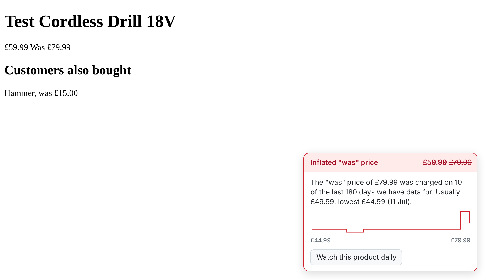

# Bargain checker

A Chrome extension that tells you, on the product page, whether a UK sale price is a **genuine deal**, a **normal price** dressed up as a sale, or backed by an **inflated "was" price**.

Phase 1 of the plan: Amazon UK, Argos, Currys, John Lewis, AO, Very and B&Q.



## Install (for testing)

1. Download or clone this repository.
2. In Chrome, open `chrome://extensions` and switch on **Developer mode** (top right).
3. Click **Load unpacked** and pick the `src` folder.
4. Visit a product on one of the supported shops. A badge appears in the bottom-right corner; click it for the details.

Optional: open the extension's **Settings** and add a [Keepa API key](https://keepa.com/#!api) (a paid Keepa plan) to get years of Amazon price history straight away.

## How it works

- **Reading the page.** The extension reads the price, the "was" price and the product barcode from the page's structured product data (schema.org JSON-LD), shop-specific selectors, and "Was £X" / "RRP £X" / "Save £X" text next to the price. See `src/lib/extract.js` and `src/lib/sites.js`.
- **Price history.** Every product page you visit records its price in your browser (`chrome.storage.local`). Products you choose to **watch** are re-checked once a day. Amazon products also use Keepa history when a key is set. Nothing is sent anywhere else.
- **Matching across shops.** When two shops show the same barcode, the card lists any cheaper price seen this week.
- **The verdict** (`src/lib/verdict.js`):
  - *Usual price* = median daily price over 90 days, ignoring the most recent 14 (when pre-sale price rises tend to happen).
  - **Genuine deal** = at least 10% below the usual price. The card also says if it has been cheaper in the last 180 days.
  - **Inflated "was" price** = the claimed "was" price was charged on fewer than 28 of the last 180 days we have data for, and today's price is not a genuine deal.
  - **Normal price** = otherwise.
  - **Not enough history** = fewer than 21 days of data in the 90-day window.
  - These thresholds are a first guess and live in `RULES` at the top of `verdict.js`.

Our own observations are assumed to hold for up to 14 days; Keepa data is change-based and holds until the next change.

## Known limits

- **History starts empty.** Apart from Amazon with a Keepa key, a product needs about three weeks of visits or daily watch-list checks before it gets a verdict. Watch the things you are thinking of buying now, ready for the next sale.
- **Shop selectors are best guesses.** They were written without access to the live shop pages, so expect to tune `src/lib/sites.js` the first time you try each shop. The structured-data and "Was £X" fallbacks cover most pages regardless.
- **Watch-list checks fetch the shop page from your browser** once a day, one product every few seconds, up to 100 products. Some shops may block or vary this; Amazon pages are not fetched (Keepa is used instead).

## Development

```sh
npm test            # unit tests (Node 18+, no dependencies)
npm run test:e2e    # loads the extension into Chromium with fake shop pages (needs Playwright)
npm run icons       # redraw the icons (needs Python + Pillow)
npm run zip         # package src/ for the Chrome Web Store
```

Code layout:

| Path | What it does |
| --- | --- |
| `src/manifest.json` | Extension manifest (Manifest V3) |
| `src/content.js` | Runs on shop pages: reads the price, shows the badge |
| `src/background.js` | Stores history, calls Keepa, runs the daily watch-list check |
| `src/lib/` | Shared logic, plain scripts that also load in Node for tests |
| `src/ui/` | Popup and settings pages |
| `test/unit/` | Node tests for parsing, sites, verdicts and Keepa |
| `test/e2e/` | Browser tests with fixture pages for Argos, Amazon and Currys |

## Next phases

See the plan: phone app with barcode scanning, then shelf-label reading, then more shops (Tesco, Sainsbury's, Asda, Boots, Next, Smyths).
